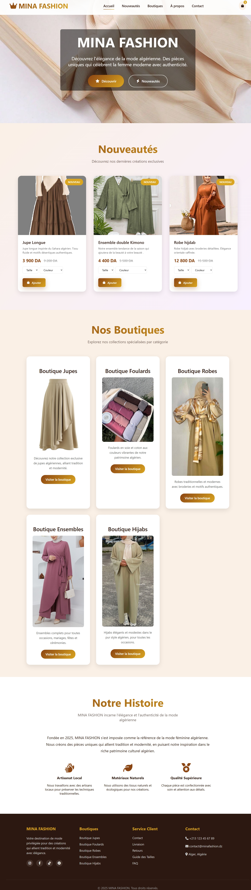

# 🛍️ Boutique en Ligne

Une boutique en ligne simple développée avec **PHP, HTML, CSS et MySQL**.  
Ce projet permet de vendre des vêtements (robes, hijabs, ensembles, jupes, foulards, pantalons…).

---

## 🚀 Fonctionnalités
- Page d’accueil avec présentation des produits
- Catalogue de produits
- Page contact
- Interface d’administration (ajout / modification produits)

---

## 📂 Structure du projet
- `index.php` → Page d’accueil
- `produits.php` → Liste des produits
- `assets/` → Fichiers CSS, JS, images
- `config/` → Connexion base MySQL
- `database.sql` → Script de la base de données

---

## 🛠️ Installation
1. Cloner le projet :
   ```bash
   git clone https://github.com/MouniraKAHLERRAS/boutique-en-ligne.git
   cd boutique-en-ligne
## 📸 Captures d’écran

### 🏠 Page d’accueil


