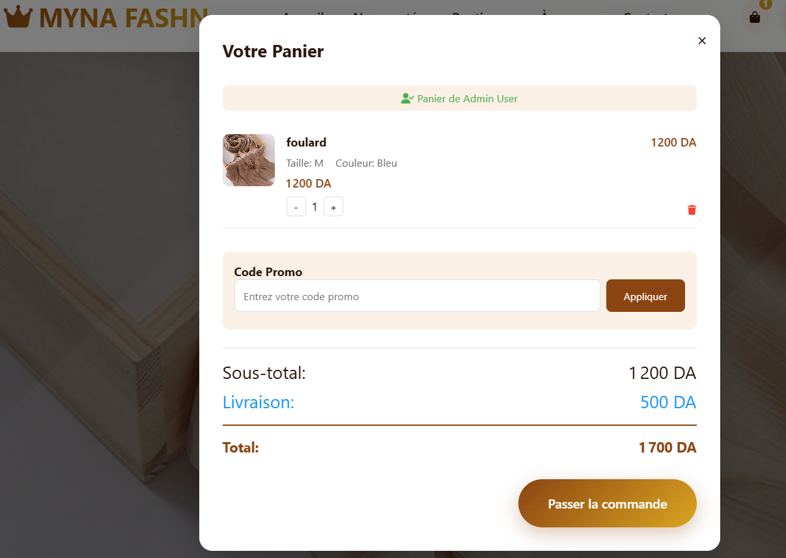

# 🛍️ Boutique en Ligne

Une boutique en ligne simple développée avec **PHP, HTML, CSS et MySQL**.  
Ce projet permet de vendre des vêtements (robes, hijabs, ensembles, jupes, foulards, pantalons…).

---

## 🚀 Fonctionnalités
- Page d’accueil avec présentation des produits
- Catalogue de produits
- Page contact
- Interface d’administration (ajout / modification produits)


---

## 🛠️ Installation
1. Cloner le projet :
   ```bash
   git clone https://github.com/MouniraKAHLERRAS/boutique--en-ligne.git
   cd boutique--en-ligne
## 📸 Captures d’écran

### 🏠 Page d’accueil


### Le panier


<<<<<<< HEAD
### System Admin

=======
### 🏠 Page d’accueil

>>>>>>> 7f2234f (Organiser les fichiers JSON dans views)

